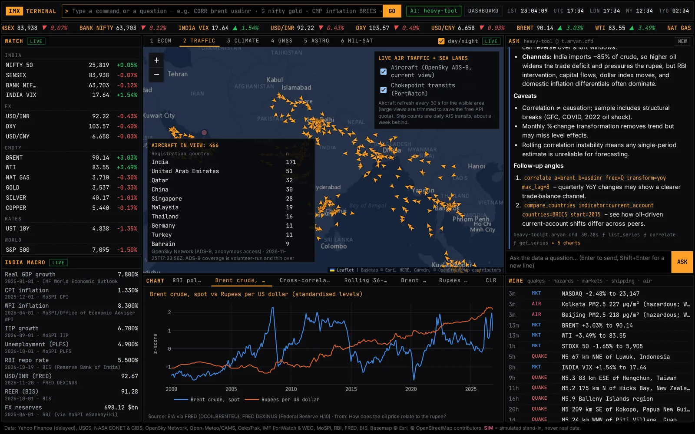
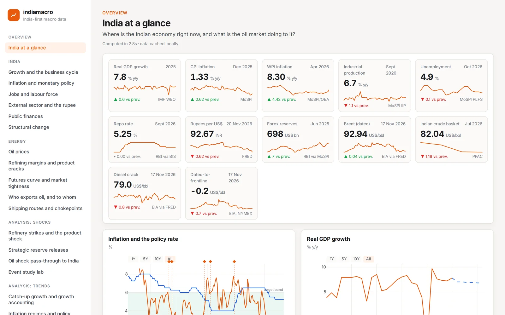
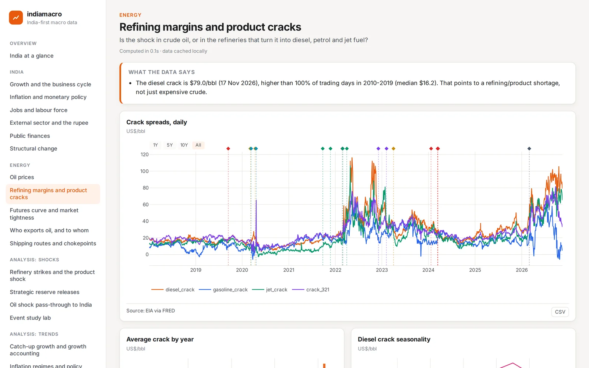
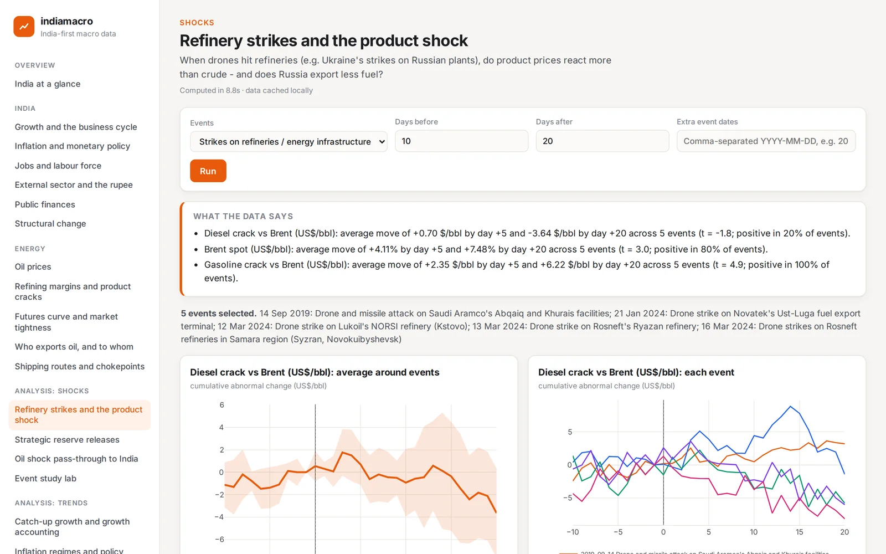

# indiamacro

India-first access to **free** macroeconomic data, with international data for comparison.
One `pip install`, tidy pandas output, consistent dates, and an on-disk cache.



```python
import indiamacro as im

im.india.snapshot()                         # latest headline numbers, with sources
im.india.cpi_inflation()                    # official MoSPI CPI inflation, monthly
im.compare("gdp_growth", "BRICS")           # India vs peers, incl. IMF projections
im.mospi.nas(9, freq="Q")                   # any MoSPI table - here quarterly GFCF
im.bis.credit_gap(["IND", "CHN"])           # BIS credit-to-GDP gap
im.pwt.get(["hc", "rtfpna"], "IND")         # Penn World Table: human capital, TFP
im.energy.cracks()                          # diesel/gasoline/jet cracks vs Brent, daily
im.energy.curve("BZ")                       # today's Brent futures curve

from indiamacro.analysis import events, run
events.event_study(im.energy.cracks()["diesel_crack"], events.select("refinery_strike"), log=False)
run("tpl_refinery", {"post": 10})           # any dashboard page, as data
```

## The dashboard

```bash
./interact                 # opens http://localhost:8765 in your browser
./interact --port 9000     # another port;  --no-browser to just serve
```

Every page is live data, rendered as interactive charts (zoom, hover, 1Y/5Y/All, PNG and CSV
download), with a "What the data says" summary computed from the numbers and a method/caveats
note you can cite.



| Refining margins and product cracks | Event study: refinery strikes |
|---|---|
|  |  |

| Section | Pages |
|---|---|
| Overview | India at a glance: 12 headline tiles (growth, CPI, WPI, IIP, jobs, repo, rupee, reserves, Brent, Indian basket, diesel crack, physical premium) |
| India | Growth and the cycle, inflation and policy, jobs, external sector, public finances, structural change |
| Energy | Oil prices (USD, INR, real, since 1960), refining margins and cracks, futures curve and market tightness, who exports oil and to whom (incl. China's product exports), shipping routes and chokepoints |
| Analysis: shocks | Refinery strikes and the product shock, strategic reserve releases, oil pass-through to India, event study lab |
| Analysis: trends | Catch-up growth and growth accounting, inflation regimes, compare countries |
| Tools | Events (add your own shock dates), data explorer, source status |

The analysis templates take parameters (event category, window, extra dates, country, indicator)
and recompute on **Run**. Events you add on the Events page (say, last week's drone strike on a
refinery) are saved to `~/.local/share/indiamacro/events.json` and immediately show up in event
studies and as markers on charts.

## The terminal

```bash
./interact                 # then open http://localhost:8765/terminal  (or the TERMINAL link in the dashboard)
```

A dense, keyboard-first monitor for journalists, analysts and investors. One screen holds:

| Panel | What it shows (all free sources, no keys) |
|---|---|
| Ticker tape + WATCH | 20 markets (NIFTY, SENSEX, USD/INR, Brent, gold, UST 10Y, S&P 500, Bitcoin...), Yahoo Finance 5-min bars, delayed |
| INDIA MACRO | Latest GDP, CPI, WPI, IIP, PLFS, repo, rupee, REER, reserves with dates and sources |
| Map: 1 ECON | IMF WEO choropleth (growth, inflation, debt, current account...), night lights, shipping chokepoints |
| Map: 2 TRAFFIC | Live aircraft in view (OpenSky ADS-B) and daily chokepoint transits vs their 1-year average (IMF PortWatch) |
| Map: 3 CLIMATE | NASA GIBS satellite layers (true colour, land temperature, rain, aerosols), USGS quakes, NASA EONET hazards, city weather and PM2.5 |
| Map: 4 GNSS | GPS, GLONASS, Galileo, BeiDou, NavIC and QZSS satellites propagated live from CelesTrak elements; how many are in view from any point |
| Map: 5 ASTRO | Day/night and twilight bands, where the Sun and Moon are overhead, moon phase, ISS and Tiangong |
| Map: 6 MIL-SAT | Publicly catalogued military and reconnaissance satellites by country, with an overflight watch for a chosen region |
| CHART | Every chart produced by a command or an answer, in tabs |
| ASK | Ask a question in plain English; the analyst runs tools (fetch, correlate with leads/lags, compare countries, event windows, live snapshot) and explains the numbers |
| WIRE | Big quakes, hazards, market moves of 1.5% or more, chokepoint anomalies, hazardous air |

Commands (press `/` to focus; Alt+1..6 switch map modes): `G india_cpi repo_rate`, `G brent yoy since 2015`,
`CORR brent usdinr`, `CMP gdp_growth G20`, `CMP inflation IND,CHN,USA`, `WIN usdinr 2025-04-02`, `SAT ISS`,
`GO Mumbai`, `LIST`. Anything else is sent to the analyst as a question.

**The analyst.** Put an OpenAI-compatible endpoint in `.env` (see `.env.example`): `LLM_ENDPOINT`,
`LLM_API_KEY`, optional `LLM_MODEL` (the `OPENAI_BASE_URL` / `OPENAI_API_KEY` / `OPENAI_MODEL` names work too).
The model must support function calling; if it doesn't, the terminal picks the tools itself and the model only
writes the answer. Without an endpoint, a **mock analyst** answers from the same tools with templated text,
clearly labelled. Every number in an answer comes from a tool result. For testing without a key:
`uv run python -m indiamacro.monitor.fake_llm` and point `LLM_ENDPOINT` at `http://127.0.0.1:8799/v1`.

**Hosted copy.** `./deploy.sh` publishes the dashboard and terminal to `https://t.aryan.cfd/indiamacro/`
(terminal at `/indiamacro/terminal`) behind a password: set `INDIAMACRO_USERNAME` and `INDIAMACRO_KEY` in
`.env` and the script writes the nginx password file, restarts the API service and checks the public URLs.

**SIM badges.** If a live source fails, its panel switches to a simulated stand-in with a pink **SIM** badge
(hover any badge for source, time and error). `INDIAMACRO_DEMO=1` forces simulation everywhere, for offline
demos. Never quote a SIM number.

## Sources

| Module | Source | What you get | Key needed |
|---|---|---|---|
| `mospi` | MoSPI eSankhyiki API | GDP/GVA and components (annual + quarterly), CPI, WPI, IIP, PLFS jobs data | no |
| `mospi.rbi` | RBI tables via MoSPI | Balance of payments, trade, exchange rates, forex reserves, external debt (39 tables) | no |
| `budget` | indiabudget.gov.in | Budget at a Glance, Annual Financial Statement, expenditure workbooks (raw sheets) | no |
| `fred` | St. Louis Fed FRED | 800k+ series; daily USD/INR, OECD MEI data for India | no (key enables `search`) |
| `worldbank` | World Bank WDI | ~1,500 annual development indicators, ~217 countries | no |
| `imf` | IMF WEO + SDMX API | Headline macro + **5-year projections**; any IMF dataset via `imf.sdmx` | no |
| `oecd` | OECD Data Explorer | Composite leading indicators, any OECD dataset via `oecd.get` | no |
| `bis` | Bank for International Settlements | Policy rates, REER/NEER, credit gaps, private credit, house prices | no |
| `pwt` | Penn World Table 11.0 | PPP GDP, capital, human capital, TFP, 185 countries since 1950 | no |
| `owid` | Our World in Data | Any OWID chart's data (Maddison GDP back to 1 CE, poverty, inequality...) | no |
| `energy` | EIA (via FRED), NYMEX (via Yahoo), World Bank Pink Sheet, PPAC, JODI, UN Comtrade, CREA, IMF PortWatch | Daily crude and product prices, crack spreads, futures curve, physical premium, Indian basket, oil exports/imports by country, Russia's exports by destination, chokepoint transits (IMF PortWatch), shipping shares | no |

Run `uv run indiamacro-ping` to test every source live; the last run is in
[docs/SOURCE_STATUS.md](docs/SOURCE_STATUS.md). [docs/SOURCES.md](docs/SOURCES.md)
lists codes, coverage and quirks for each source.

**Not automated:** RBI's own DBIE portal (its API needs registration, session tokens
and a captcha; the main RBI tables come via MoSPI and BIS instead) and CMIE (paid).

## Install

```bash
cd indiamacro
uv sync                    # or: pip install -e .
uv run pytest              # offline unit tests
uv run pytest -m live      # live tests against every source
uv run --extra plot python examples/india_vs_peers.py   # charts -> examples/output/
./interact                 # the dashboard
```

## Conventions

- **Long format.** Source functions return `date, country, series, value` (plus
  source-specific columns). `im.wide(df)` pivots to a date x country table.
- **Dates mark the start of the period.** 2024 -> 2024-01-01, Q2 -> 04-01, and
  Indian fiscal year 2024-25 -> 2024-04-01. The original label is kept in `period`.
- **Countries** can be names, ISO2 or ISO3 codes, or groups: `BRICS`, `BRICS+`, `G7`,
  `G20`, `SOUTH_ASIA`, `ASEAN`, `EM_ASIA`, `QUAD`. India always comes first.
- **`india.*` functions** return a `pandas.Series` whose `.attrs` hold the source,
  unit and notes, which is everything you need for a chart caption or citation.
- **Caching.** Responses are cached in `~/.cache/indiamacro` for a day (Penn World
  Table forever). `im.settings.cache = False` or `im.clear_cache()` to refresh.

## Things that will trip you up (and impress your professor if you handle them)

1. **Base-year changes.** India rebased GDP and IIP to 2022-23 and CPI to 2024 in
   2025-26. Old- and new-base series are different series; every MoSPI function
   returns a `base_year` column. Compare growth rates across bases, not levels.
2. **Revisions.** GDP goes through advance, provisional, revised and final estimates.
   `mospi.nas()` returns all vintages in `revision`; `india.gdp()` keeps the latest.
3. **Fiscal vs calendar years.** MoSPI and the IMF report India by fiscal year
   (IMF "2024" = FY 2024-25). World Bank data for India are fiscal-year based too.
4. **Projections.** IMF WEO mixes actuals and forecasts; `imf.weo()` flags them in a
   `projection` column (from the IMF's own "latest actual" metadata).
5. **Freshness.** The MoSPI API can lag the official press releases (as of Oct 2026
   the base-2024 CPI and post-April-2026 WPI weren't loaded yet). For the very
   latest print, check the MoSPI/RBI press release and say so in your footnote.

See **[LIMITATIONS.md](LIMITATIONS.md)** for the full list: missing data, lags, proxies,
method caveats of each template, and which connections are fragile.

## For developers

Architecture, data shapes, recipes for adding sources/pages/series/feeds, debugging, known pitfalls,
testing and deployment are in [docs/README.md](docs/README.md).

## Citing

Cite the original producer, not this package: e.g. *National Statistics Office,
MoSPI, CPI (base 2012=100), accessed via the eSankhyiki API on 8 Oct 2026*. Each
`india.*` series carries its source in `s.attrs["source"]`; PWT and OWID modules
document their required citations.
